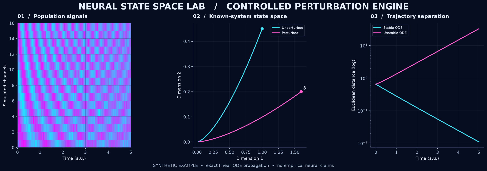
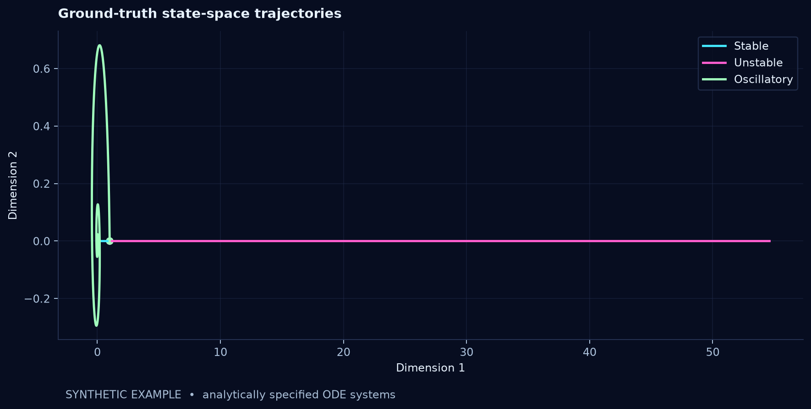
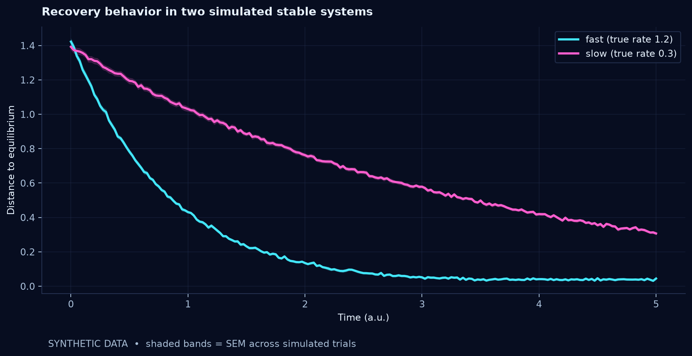
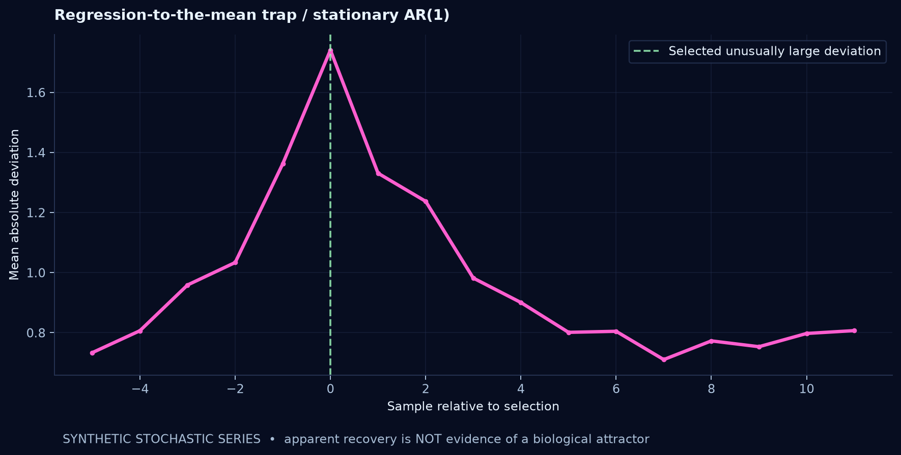

<div align="center">

# NEURAL STATE SPACE LAB

### An Open-Source Perturbation and Recovery Toolkit for Neural Population Dynamics

**Explore neural trajectories · Change states in a mathematical model · Measure what happens next**

  



*This figure is generated from simulated signals and exact mathematical models. **Not an empirical EEG recording or biological finding.***

[Start here](START_HERE.md) · [Scientific concepts](docs/concepts.md) · [Limitations](docs/limitations.md) · [Source code](src/nssl/)

</div>

## 1. What is Neural State Space Lab?

The brain produces many interacting signals. A **neural state space** is a way of representing activity from many neurons or recording channels as a point moving through a mathematical space. As it moves, it traces a *trajectory*.

**Neural State Space Lab (NSSL)** is an open-source Python research toolkit for investigating those trajectories. It can organize recordings, make controlled changes to a modeled neural state, propagate that state using a clearly defined dynamical system, and measure its approach to or separation from a reference. This is research software, not a diagnostic application or physical brain stimulation technology.

## 2. What can the software do?

| Question | Available tool |
|---|---|
| How do I organize neural recordings? | Validated trials × channels/features × time arrays |
| Can I simplify high-dimensional activity? | PCA or Factor Analysis fitted on training data |
| What is a representative trajectory? | Training-condition and leave-one-out references |
| How do I introduce a computational change? | Isotropic, directional, residual-based or state-swap displacement |
| What happens after a changed state? | Exact linear ODE or training-fitted ridge transition model |
| How can I measure recovery or divergence? | Distance, recovery fraction/time, separation, divergence and directional restoration |
| Could an apparent effect be misleading? | Regression-to-the-mean example and assumption-dependent null transformations |
| How can I describe uncertainty? | Bootstrap intervals and empirical permutation probabilities |

**Important:** Changing coordinates at one time point does not automatically generate a meaningful future trajectory. NSSL requires an explicit propagation model. Model forecasts are not real-world observed reactions.

## 3. How does it work?

```text
Recorded neural signals or simulated data
                  ↓
          Validate data and labels
                  ↓
        Fit preprocessing on TRAINING data
                  ↓
          PCA / Factor Analysis
                  ↓
           State-space paths
                  ↓
       Define reference trajectory
                  ↓
      Change a state computationally
                  ↓
        Propagate it through a model
                  ↓
      Measure recovery or divergence
                  ↓
      Evaluate controls and assumptions
                  ↓
          Plot and interpret
```

Read the [scientific assumptions](docs/scientific_assumptions.md) for the difference between observation, known-system simulation and model-dependent extrapolation.

## 4. Scientific visualizations

**Every figure here is created from seeded synthetic data or explicitly defined mathematical systems.** These are not experimental brain measurements.

**Stable, unstable and oscillatory model trajectories**



**Two simulated conditions with different recovery rates**



**Why apparent recovery may be misleading**



The last figure shows how selecting unusually extreme measurements can produce later reductions even without a restorative mechanism.

All plots are generated by [`src/nssl/demo.py`](src/nssl/demo.py), not manually invented results. If these assets are not present in a checkout, run `nssl-demo --output assets` after installation.

## 5. Getting started

**Windows PowerShell** (inside the cloned repository folder):

```powershell
py -3.11 -m venv .venv
.venv\Scripts\Activate.ps1
python -m pip install -e ".[dev]"
python -m pytest -q
nssl-demo --output outputs/synthetic
```

**macOS or Linux:**

```bash
python3 -m venv .venv
source .venv/bin/activate
python -m pip install -e ".[dev]"
python -m pytest -q
nssl-demo --output outputs/synthetic
```

The synthetic demonstration requires no participant data. Python 3.10 or newer is required. Clean Windows setup and public EEG download require separate verification.

## 6. Run your first experiment

Try this complete **synthetic** example:

```python
import numpy as np
from nssl.dynamics import LinearContinuousDynamics
from nssl.simulation import system_matrix
from nssl.metrics import local_trajectory_separation, recovery_fraction

times = np.linspace(0, 5, 201)
initial = np.array([[1.0, 0.5]])
changed = initial + np.array([[0.4, 0.0]])

model = LinearContinuousDynamics(system_matrix("stable"))
result = model.compare(initial, changed, times)
distance = local_trajectory_separation(result.perturbed, result.baseline)

print("Initial separation:", distance[0, 0])
print("Final separation:", distance[0, -1])
print("Recovery fraction:", recovery_fraction(distance)[0])
```

This uses a **specified linear dynamical system**, not a fitted brain model or recorded stimulation response.

## 7. Understanding results

**Trajectory separation** is the distance between baseline and changed-state paths. The **recovery fraction** measures how much this distance decreases over a defined interval: positive values indicate a smaller final distance, zero means no change, and negative values indicate greater separation. These descriptive quantities do not prove an underlying biological attractor.

Interpretation requires the perturbation size, reference, observation window, model assumptions, independent sampling unit and suitable null controls. Explore [metrics](docs/metrics.md) and [null models](docs/null_models.md).

## 8. Scientific validation

Local archive validation reported **39 passing tests**, synthetic demonstration execution, wheel build and imported installation, including offline tests of explicit MNE event mapping. These results **do not** establish native Windows execution, downloaded PhysioNet EEG results, remote CI status or biological validation. See the [validation report](VALIDATION_REPORT.md) and the repository [Actions](https://github.com/lathushanrk-cmd/neural-state-space-lab/actions) tab for the actual remote status.

## 9. Project structure

| Location | Contents |
|---|---|
| [`src/nssl/`](src/nssl/) | Installable Python research toolkit |
| [`tests/`](tests/) | Mathematical, numerical and edge-case tests |
| [`assets/`](assets/) | Seeded synthetic plots and numerical output |
| [`reproduce/`](reproduce/) | Plot generation, benchmarking and optional EEGBCI example |
| [`docs/`](docs/) | Scientific and statistical explanations |
| [`examples/`](examples/) | Jupyter notebooks |
| [`.github/workflows/`](.github/workflows/) | Automated checks and figure generation |

## 10. Documentation and tutorials

[Introduction](docs/index.md) · [Input data](docs/data.md) · [Perturbations](docs/perturbations.md) · [Dynamics](docs/dynamics.md) · [Statistics](docs/statistics.md) · [Experimental design](docs/experimental_design.md) · [Simulation tutorial](docs/tutorials/01_stable.md) · [Selection bias tutorial](docs/tutorials/02_regression.md) · [EEG tutorial](docs/tutorials/03_eeg.md).

### Optional public EEG example

The [EEGBCI demonstration](reproduce/eegbci_demo.py) is designed for a **single-participant observational analysis** of public [PhysioNet EEG Motor Movement/Imagery](https://physionet.org/content/eegmmidb/) data. It maps `T1` to hands (2) and `T2` to feet (3), excludes rest cues, and learns transformations only on training trials. It has **not been independently executed and verified against downloaded recordings**.

```bash
python -m pip install -e ".[eeg]"
python reproduce/eegbci_demo.py
```

This trial split does not establish cross-participant or cross-session generalization.

## 11. Reproduce the figures

```bash
python -m pytest -q
python reproduce/figure_1.py
python reproduce/figure_2.py
```

Both plotting scripts regenerate the same seeded figures in `assets/`. Their numerical results are recorded in [`assets/simulation_results.json`](assets/simulation_results.json). Do not interpret synthetic plots as independent experimental neuroscience evidence.

## 12. Limitations

- **In-silico** perturbation is not TMS, DBS or physical stimulation.
- A trained transition-model rollout is a hypothetical forecast, not an observed causal response.
- Distance to a changing reference can shrink without any neural attracting system.
- Selecting extreme observations can introduce regression to the mean.
- Statistical permutations and bootstraps require valid exchangeability and sampling assumptions.
- NSSL is **not clinically validated** and cannot be used to diagnose or treat disease.

Read [all limitations](docs/limitations.md) before making empirical claims.

## 13. Author

**Lathushan RK**  
Independent researcher

Research interests: computational neuroscience, neural dynamics, brain-state representation and neurophysiology.

## 14. Citation, contribution and license

Cite the specific repository version used. [`CITATION.cff`](CITATION.cff) provides software metadata; **no DOI or peer-reviewed validation is claimed**. Contributions are welcome under [`CONTRIBUTING.md`](CONTRIBUTING.md).

Released under the [MIT License](LICENSE). Current source version: **0.9.0 (research pre-release candidate)**.
